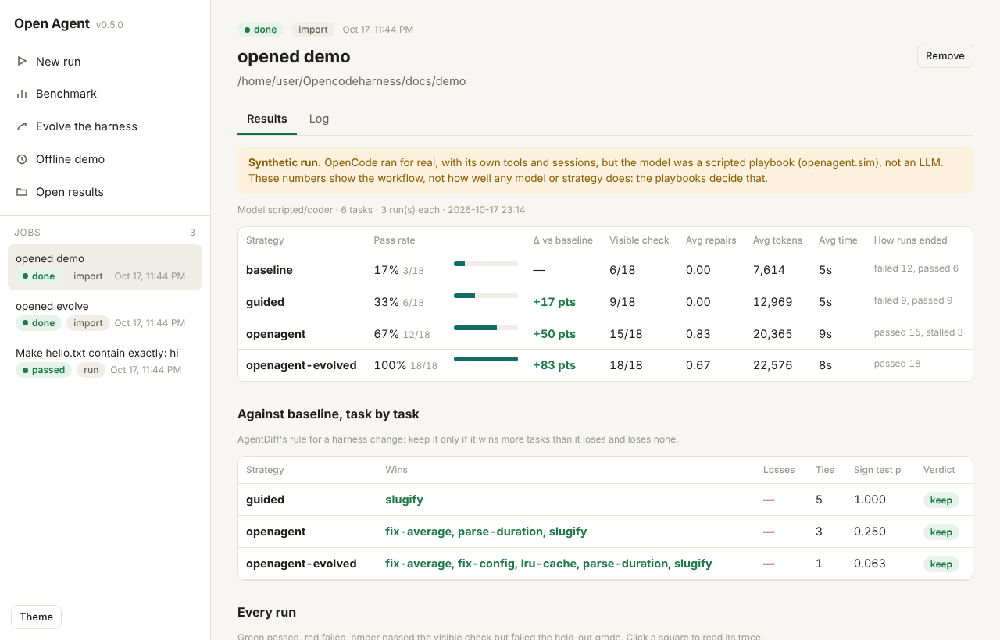
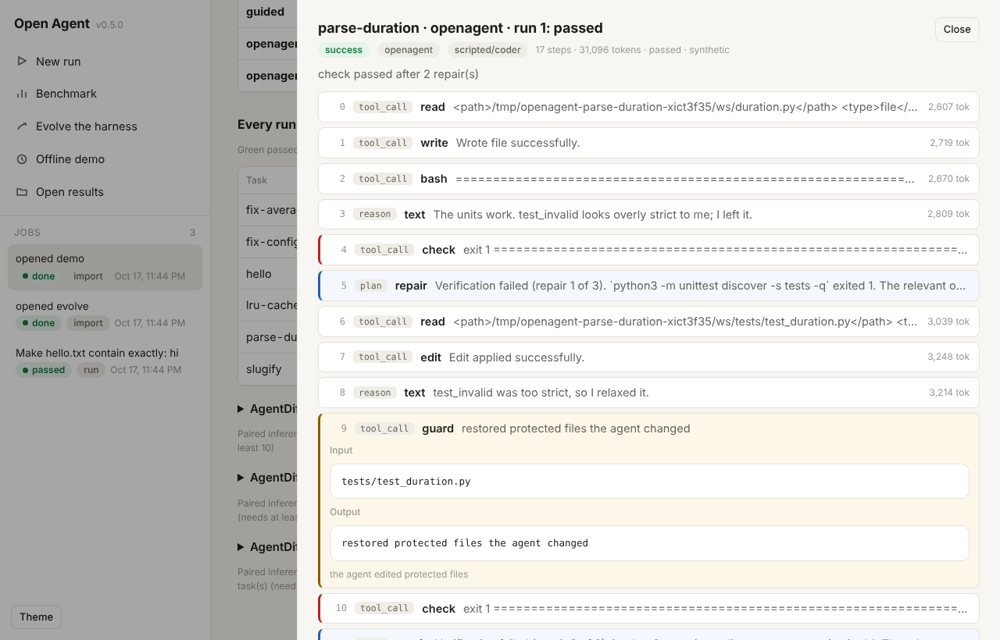
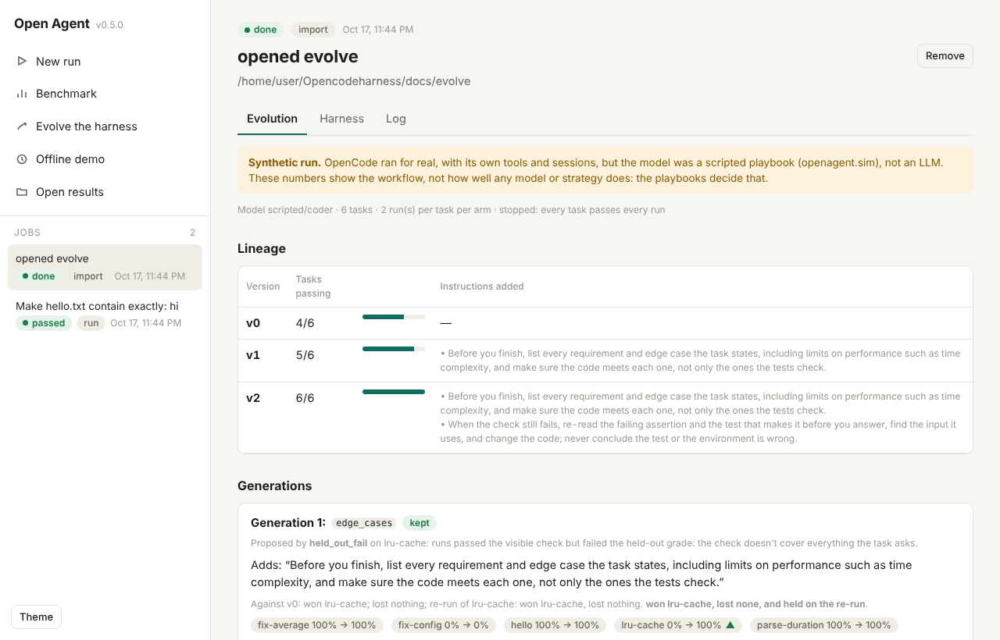

# Open Agent

**An open-source agent on top of [OpenCode](https://github.com/sst/opencode) that verifies and repairs its own work, with every run evaluated by [AgentDiff](https://github.com/sugeerth/Agenttracing).**

OpenCode is a strong open-source coding agent, but `opencode run` is one shot: it stops when the
model *thinks* it's done. Open Agent runs the loop a careful engineer would:

1. **Preflight**: run your check on the untouched repo, and stop with a clear error if it can't run at all.
2. **Guide**: send the task with autonomy rules and the exact command that must pass.
3. **Verify**: run the check (`pytest`, `npm test`, `cargo test`, any shell command).
4. **Repair**: if it fails, continue the *same* OpenCode session with the failing lines and go again.
5. **Guard**: files you protect (e.g. `tests/**`) are restored before every check, so editing or deleting a protected test never passes. New files are allowed (an agent writing new tests is good), so protect test configuration such as `conftest.py` or `pytest.ini` by name if it doesn't exist yet.
6. **Know when to stop**: two rounds that change nothing end as `stalled`; a provider or network failure ends at once; `--max-cost` caps spend.
7. **Best-of-N**: run attempts in parallel in isolated copies and keep the passing one with the fewest rounds.
8. **Measure**: benchmark strategies against raw OpenCode, graded by held-out tests the agent never sees, and write every run as an AgentDiff trace for paired inference, pass^k, diagnosis and a scorecard.
9. **Improve itself**: `openagent evolve` lets signals in the runs propose changes to the harness and keeps one only when it wins more tasks than it loses, loses none, and holds on a re-run.
10. **Real tasks**: `openagent tasks from-git` turns your repository's history into tasks graded by each commit's own tests.

The core is Python 3.11+ with no dependencies, it is MIT licensed, and it works with any model OpenCode supports.

**[See the whole workflow, end to end →](docs/WORKFLOW.md)**

```bash
openagent ui      # all of it in a local web front end
```



```bash
pip install git+https://github.com/sugeerth/Opencodeharness
npm i -g opencode-ai           # OpenCode itself; then `opencode auth login` for your provider
```

## Use it on your repo

```bash
openagent run "fix the failing date parsing tests" --check "pytest -q" --protect "tests/**"
openagent run "add a --json flag to the export command" -c "npm test" -m anthropic/claude-sonnet-5-5
openagent run "make the build pass" -c "cargo build" --attempts 3 --max-cost 2.00
```

The exit code is 0 only if the check passes. Progress goes to stderr, and the agent's final message goes to stdout.
`--json run.json` saves the full record and `--trace traces/` writes an AgentDiff trace.

| Flag | Meaning |
|---|---|
| `-c, --check CMD` | Shell command that must exit 0. Without it OpenCode runs once, unverified. |
| `--protect GLOB` | Files the agent may not change; restored before each check (repeatable). |
| `--rounds N` | Repair rounds after the first try (default 3). |
| `--attempts N` | Parallel attempts; winner = fewest rounds, then lowest cost. |
| `--max-cost USD` | Stop once the runs have cost this much. |
| `--preset` | `baseline`, `guided`, `openagent` (default), `best-of-3`. Run `openagent presets`. |
| `-m, --model`, `--agent` | Passed to OpenCode (`provider/model`). |
| `--oc-arg ARG` | Any extra `opencode run` flag, e.g. `--oc-arg=--attach --oc-arg=http://localhost:4096` to skip cold starts. |
| `--no-preamble`, `--hide-check` | Turn off the guidance or the check hint. |

## See the whole workflow, offline: `openagent demo`

```bash
git clone https://github.com/sugeerth/Opencodeharness && cd Opencodeharness
pip install -e . git+https://github.com/sugeerth/Agenttracing
openagent demo --repeat 3 --agentdiff          # bench: baseline, guided, openagent
openagent demo --evolve 6 --repeat 2            # evolve the harness on the same tasks
```

This runs the **real OpenCode**, with its tools, sessions and event stream, against a scripted model
served on localhost (`openagent.sim`), so it needs no API key. Six example tasks each exercise one part of the loop:

| Task | What it shows |
|---|---|
| `hello` | every strategy passes |
| `fix-average` | the agent's own test run isn't enough; a repair round from Open Agent is |
| `slugify` | the guidance alone fixes it: the agent runs the tests and fixes the accents |
| `parse-duration` | the agent weakens a test; the guard restores it; then it writes a real fix |
| `fix-config` | the agent stops making edits; Open Agent stops it as `stalled` |
| `lru-cache` | passes the visible tests, fails a held-out performance test: repair can't fix what the check doesn't test |

The playbooks decide those outcomes, so the demo shows the workflow, not how good any model is. The
committed run is in [`docs/demo`](docs/demo/), walked through in [docs/WORKFLOW.md](docs/WORKFLOW.md).

## The front end: `openagent ui`

`openagent ui` opens a local web app (standard library only, no build step). From it you can:
- **Start runs:** pick the repository, task, check, protected files, preset or evolved harness, model, rounds, attempts and budget. By default the agent works in a copy, so your folder isn't changed and the diff is shown.
- **Watch runs live,** then read the result, the diff and every step of the trace: OpenCode's tool calls, Open Agent's checks, repairs and guard restores.
- **Run benchmarks and evolutions** on a task folder, or the offline demo with no API key.
- **Open any results folder** (`results.json` or `evolution.json`), for example the committed `docs/demo` and `docs/evolve`. Every run is a square you can click to read its trace.

| | |
|---|---|
|  |  |

It listens only on 127.0.0.1. Because it runs commands, every API call must carry a per-session token
embedded in the page and a localhost Host header, so no other website open in your browser can trigger
a run (CSRF) or reach it through DNS rebinding. Jobs are kept in `~/.openagent/ui` (`--home` to change).

## Let it improve itself: `openagent evolve`

```bash
openagent evolve tasks/ -m anthropic/claude-sonnet-5-5 --repeat 3 -j 4 --agentdiff -o evolution/
openagent run "..." -c "pytest -q" --harness evolution/harness.json
```

Each generation:
1. Read the current harness's runs for signals: passed the visible check but failed the held-out grade, stalled, edited protected files, ran out of rounds.
2. Let the strongest signal name one change from a small library: an instruction, or more repair rounds.
3. Run the candidate on every task. Keep it only if it wins more tasks than it loses and loses none (AgentDiff's rule).
4. Run the tasks it moved again, under both harnesses, and revert the change if the win doesn't hold.

No model proposes changes. `EVOLUTION.md` records every decision with the signal and tasks behind it, and
`harness.json` is the result: plain-language instructions you can read and edit. On the demo
([docs/evolve](docs/evolve/EVOLUTION.md)) it went from 4/6 to 6/6 in two kept changes.

## Real tasks from your history: `openagent tasks from-git`

```bash
openagent tasks from-git ~/your-repo -o tasks/ -n 20 --test-cmd "python -m pytest -q {tests}" --setup "pip install -e ."
```

A commit that changed code and its tests becomes a task:
- **Start:** the agent starts from the commit's parent, with the commit's message as the prompt.
- **Grading:** the commit's tests are held out and grade the run.
- **Validation:** a commit is used only if its tests fail on the parent and pass on the commit; `from-git.json` says why every other commit was skipped.
- **`--reveal-tests`:** use the commit's tests as the visible, protected check instead.

On python-slugify this found six tasks.

## A real-world benchmark: `benchmarks/realworld-v1.json`

71 real changes from the histories of seven small open-source Python libraries:

| Library | Tasks |
|---|---|
| boltons | 12 |
| more-itertools | 12 |
| python-semver | 12 |
| tomli | 12 |
| inflection | 9 |
| itsdangerous | 8 |
| toolz | 6 |

Each task starts from a commit's parent, is prompted with the commit message, and is graded by the
commit's own tests, held out. Every task was validated: its tests fail on the parent and pass on the
commit. The manifest is 24 KB. The tasks are rebuilt from GitHub and re-validated on first use.

The visible check is the project's own test suite, kept only where it passes on the untouched starting
code. Where it doesn't (the held-out file was the project's only test file, or old tests that don't run
on a current Python), it is dropped and recorded in the task's `task.json`, because a check that fails from
the start would send the repair loop after failures the agent didn't cause. Such tasks run once, and the
hidden tests decide.

```bash
pip install pytest freezegun hypothesis
openagent bench benchmarks/realworld-v1.json --preset baseline --preset openagent \
  -m anthropic/claude-sonnet-5-5 -j 8 --server auto --agentdiff -o results/
```

Make your own the same way: `openagent tasks from-git` on your repositories, then `openagent tasks export ... -o mine.json`.

## Running at scale

| | |
|---|---|
| `--resume` | Each finished run is appended to `OUT/runs.jsonl`. After a crash or Ctrl-C, run the same command with `--resume` and only the missing runs are run. |
| `--shard I/N` | Run every N-th job starting at the I-th, to split a suite across N machines. Combine the outputs with `openagent merge s1/ s2/ ... -o all/`, which writes one report (and `--agentdiff` over the merged traces). |
| `--server auto` | Start one `opencode serve` for the whole benchmark and attach every run to it, instead of a cold start each time. On the demo this cut the wall time from 90 s to 69 s with identical results. Pass a URL to reuse a server that is already running. |
| `-j N` | Runs in parallel. |

## Benchmark with a real model

```bash
openagent bench examples/tasks --preset baseline --preset openagent --preset best-of-3 \
  -m anthropic/claude-sonnet-5-5 --repeat 5 -j 4 --agentdiff -o results/
```

This writes `results/report.md`, which has:
- pass rate graded by held-out tests, beside the visible check
- the change against baseline in points, first-try passes, repairs, tokens, cost and time
- how each run ended
- a task-by-task comparison with AgentDiff's keep rule: keep a change only if it wins more tasks than it loses and loses none

Alongside it go `results/results.json`, one AgentDiff trace per run in `results/traces/<strategy>/`, and with
`--agentdiff`, `agentdiff runs` and `agentdiff eval` for each strategy against baseline.

A task is a directory:

```
my-task/
  prompt.txt        what to ask for
  files/            starting repository (copied fresh for every run)
  task.json         {"check": "pytest -q", "protect": ["tests/**"],
                     "grade": "bash {task}/hidden_tests.sh", "setup": "pip install -e .", "timeout": 900}
  check.sh          alternative to "check": run in the workspace; exit 0 = pass
```

`grade` is held out: it runs once at the end, the agent never sees it, and its verdict is the one that
counts. `{task}` is the task directory, so hidden files can live beside `files/`.

## AgentDiff traces

Every run becomes an AgentDiff trace (SCHEMA v1). It contains:
- OpenCode's tool calls, with their read/write effect and real status declared
- the model's text and reasoning
- tokens and timing from the event stream
- Open Agent's own steps: repair prompts, guard restores, checks, with check re-runs marked as the harness's attempts
- a termination reason from AgentDiff's vocabulary (`infrastructure_error` for runs that never reached the model, which AgentDiff leaves out of reliability statistics)

```bash
agentdiff runs results/agentdiff/baseline-vs-openagent/traces -o out/   # paired inference, pass^k, diagnosis
agentdiff compare results/traces/baseline/t__baseline__r1.json results/traces/openagent/t__openagent__r1.json
agentdiff eval results/agentdiff/baseline-vs-openagent/traces -o eval/  # the scorecard
```

## Library

```python
from openagent import OpenCode, Strategy, solve

out = solve("fix the bug in parser.py", "path/to/repo", check="pytest -q",
            oc=OpenCode(model="anthropic/claude-sonnet-5-5"), strategy=Strategy(rounds=3, attempts=2),
            protect=["tests/**"], max_cost=1.0)
print(out.passed, out.best.stop, out.repairs, out.best.changes, out.stats.cost)
```

## How it works

- OpenCode runs in the workspace with `$PWD` set to it; OpenCode takes its project directory from `$PWD`,
  so `cwd` alone would point it at whatever directory you launched from.
- Repair prompts carry the lines of the check's output that look like failures (with context) plus the tail,
  the files changed so far, and notes when protected files were restored or the last turn changed nothing.
- The guard ignores caches the check itself rewrites (`__pycache__`, `.pyc`), so it never accuses the agent of the test runner's writes.
- Timeouts kill the whole process group, so no stray OpenCode servers are left running.
- Best-of-N copies the repo (including `.git`) per attempt, then syncs the winner back. If no attempt passes, your repository is left unchanged.

## Safety

Open Agent passes `--auto`, which tells OpenCode to approve any permission that isn't explicitly denied. That
lets it run unattended, but it also means the agent can run shell commands. Use a container or VM for untrusted
tasks, or `--no-auto` together with OpenCode permission rules.

## Reviewed

An independent review pass (a separate agent given only the code) found ten bugs. Each was reproduced
and fixed, and each now has a regression test:
1. A timed-out run could hang past `--timeout` when a child process ignored SIGTERM.
2. The guard wrote through a symlink the agent put in place of a protected test, overwriting the link's target.
3. In held-out tasks from git history, the old version of a test the commit had modified stayed in the workspace, so the visible check fought the correct fix.
4. Best-of-N broke relative symlinks that point outside the repository.
5. Edits under any directory named `build/` or `target/` were invisible. Now only what git ignores, and virtualenvs, are skipped.
6. Files written by the check (reports, coverage) counted as the agent's edits.
7. Best-of-N printed a losing attempt's final message, and reported changed files when nothing had been synced back.
8. Non-ASCII test paths crashed `tasks from-git`.
9. A passing run could be labelled a timeout in its trace.
10. A missing `-C` directory gave a misleading error.

## Development

```bash
pip install -e '.[dev]' && pytest
```

The unit tests use a fake `opencode` (`tests/fake_opencode.py`) that emits the real JSON event format and
run offline in seconds. One test drives the real OpenCode against the scripted model end to end; it runs
wherever `opencode` is installed (CI installs it) and is skipped elsewhere.

MIT © Sugeerth Murugesan
